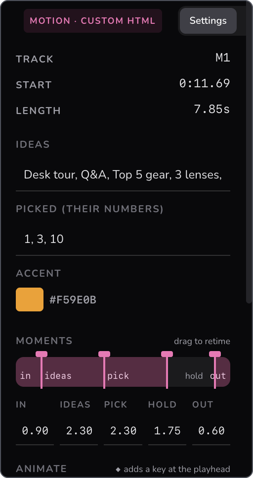
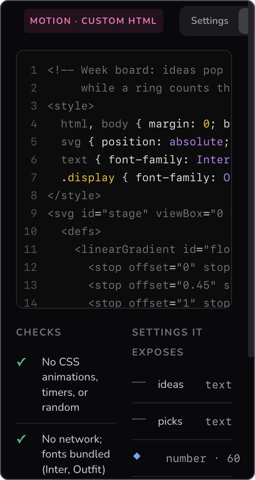
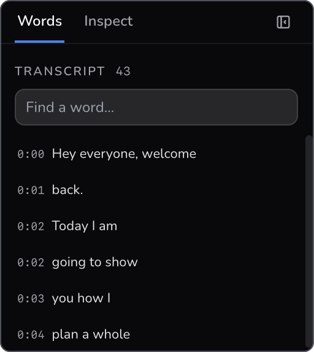
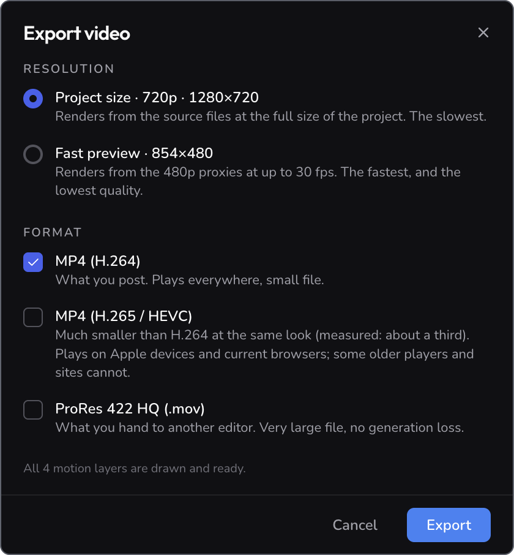

<div align="center">

# FrameFlow

### Talk to your video editor.

Drop in your footage and say what you want.<br>
FrameFlow builds the cut on a real timeline, so you can still change anything by hand.

<br>

[](https://github.com/navidshad/frameflow/releases/latest)
[](https://github.com/navidshad/frameflow/releases/latest)
[](https://github.com/navidshad/frameflow/releases/latest)

<br>

<picture>
  <source media="(prefers-color-scheme: dark)" srcset="docs/readme/hero-dark.webp">
  <source media="(prefers-color-scheme: light)" srcset="docs/readme/hero-light.webp">
  
</picture>

<sub>A desktop app for macOS, Windows and Linux · Free for personal and other noncommercial use</sub>

</div>

<br>

## What people make with it

### 1 · Clean up a talking video

<table>
<tr>
<td width="56%" valign="top">

**For vloggers, teachers and anyone who records themselves.**

Type one sentence:

> *Cut the filler words, the false start and the long pauses. Keep everything else in order.*

FrameFlow listens to the recording, finds the slips and gives back a tighter cut. Here a 64-second take became 35 seconds.

- The answer tells you what was cut, and why.
- Every cut is marked on the timeline. Drag any edge to change it.
- One click takes you back to the version before.

</td>
<td width="44%">

</td>
</tr>
</table>


<br>

### 2 · Cut a two-camera podcast

**For podcasts, interviews and panels.**

Add the files from every camera. FrameFlow notices they are one recording and lines them up by their sound.

<p align="center">

</p>

Then every angle sits under the picture. Ask for the cut, or press **1**, **2**, **3** to switch cameras yourself while it plays.

> *Cut between the cameras so we always see whoever is speaking.*


<br>

### 3 · Add motion graphics

**For explainers, tutorials and channel branding.**

Not just a name tag over a video. A motion layer in FrameFlow is a small page drawn frame by frame, so it can be a whole animated scene: a board that fills up, a chart that grows, a map, a character.

<p align="center">

</p>

<p align="center"><sub>One motion layer, exported from FrameFlow. Twelve ideas pop in, three are picked and fly to their days, and a ring counts the hour.</sub></p>

Start from a template (name tags, chapter cards, quotes, counters, callouts), write your own scene, or ask the assistant to make one. It sits on its own track, above the footage.


<table>
<tr>
<td width="50%" valign="top" align="center">
<br>
<sub><b>Change the words, not the code.</b><br>Every scene shows its own settings and timing.</sub>
</td>
<td width="50%" valign="top" align="center">
<br>
<sub><b>Checked before it is drawn.</b><br>The export matches the preview, frame for frame.</sub>
</td>
</tr>
</table>

<sub>These tools live in <b>Pro</b> mode. Switch between Light and Pro in the top bar. One button also adds a sound to each entrance.</sub>

<br>

### 4 · Make the thumbnail

**For anyone who posts the video afterwards.**

Press **Thumbnail**. FrameFlow picks frames from your video, writes a first request from its title and what is said in it, and makes a cover image. Every version stays on a board, so you can compare them and continue from the one that worked.


<br>

## How it works

<table>
<tr>
<td width="33%" valign="top">

**1. Add your footage**

Files from your computer, or a link from YouTube or Google Drive.

</td>
<td width="33%" valign="top">

**2. Say what you want**

Or cut by hand. The assistant and your mouse work on the same timeline.

</td>
<td width="33%" valign="top">

**3. Export**

MP4 for posting, or ProRes to hand to another editor.

</td>
</tr>
</table>


<br>

## Also inside

<table>
<tr>
<td width="50%" valign="top" align="center">
<br>
<sub><b>Edit by reading.</b><br>Search what was said. Cut a word, or every "um" at once.</sub>
</td>
<td width="50%" valign="top" align="center">
<br>
<sub><b>Export that explains itself.</b><br>Each format says what it is for.</sub>
</td>
</tr>
</table>

- **Light and Pro.** Light keeps the essentials: cut, trim, titles, captions, export. Pro adds animation, transitions, effects and sound design.
- **Nothing is lost.** Every AI turn is saved as a version. Go back to any of them, or branch from one.
- **Cover a face.** Ask the assistant to follow a face or an object through a shot and keep an emoji or a shape on it.
- **Captions** from the transcript, on or off with one button.
- **Persian and Arabic** text works in titles.

<br>

## Bring your own AI agent

Already use Claude Code or Codex? Turn on **Agent access** and it can work on the project you have open, with the same tools as the built-in assistant. Each change it makes is saved as a version you can undo.

<p align="center">

</p>

<sub>Off until you switch it on. It listens on this computer only and needs the token shown here.</sub>

<br>

## Get FrameFlow

Installers are on the [**Releases**](https://github.com/navidshad/frameflow/releases) page.

| Platform | File |
| :--- | :--- |
| **macOS** (Apple Silicon) | `.dmg`, signed and notarised |
| **Windows** (x64) | `.exe`, not signed yet, so SmartScreen will warn |
| **Linux** (x64) | `.AppImage` or `.deb` |

**What you need**

- A **Google Gemini API key**. FrameFlow asks for it on first launch and uses it for transcripts, scene descriptions and images. You get one at [Google AI Studio](https://aistudio.google.com/app/apikey).
- Optional: **Claude Code**, if you want it to do the editing. It runs on your own Claude plan.
- Optional: an **ElevenLabs** key for generated voice, music and sound.

Your projects stay in a folder on your computer. AI features send the sound or frames they need to the AI service you chose.

<br>

## For developers

<details>
<summary><b>Run from source</b></summary>

<br>

You need Node.js 24 (22.12 at the least). FFmpeg, scene detection and yt-dlp ship with the app.

```bash
git clone https://github.com/navidshad/frameflow.git
cd frameflow
npm install
npm run dev
```

Use npm, not yarn. More in the [setup guide](./docs/setup.md).

</details>

<details>
<summary><b>Build for an Intel Mac</b></summary>

<br>

There is no prebuilt Intel installer. On an Intel Mac, or on Apple Silicon (it cross-builds), from a clone of this repo:

```bash
npm_config_arch=x64 npm ci
npm run build && npx electron-builder --mac --x64
```

The installer lands in `dist/`. Without a Developer ID certificate it is unsigned, so macOS asks you to right-click and choose Open the first time.

</details>

<details>
<summary><b>How it is built</b></summary>

<br>

FrameFlow is an Electron app (Vue 3, FFmpeg). The AI never touches your media: it proposes edits as checked operations on a timeline, and each turn becomes a version you can undo. A local MCP server (off by default, `127.0.0.1` only, with a token) gives outside agents the same tools the built-in assistant uses.

| Topic | Read |
| :--- | :--- |
| The two workflows and the editor's AI contract | [Architecture](./docs/architecture.md) |
| AI agents, MCP and motion layers | [Agents and motion](./docs/agent-and-motion.md) |
| Syncing cameras and finding who speaks | [Multicam](./docs/multicam.md) |
| What happens when you import a file | [Import lanes](./docs/import-lanes.md) |
| Frontend components | [UI overview](./docs/ui_ux.md) |
| Cutting a release, signing and notarising | [Releasing](./docs/releasing.md) |

Supported inputs: `.mp4` `.mov` `.avi` `.webm` video, `.mp3` `.wav` `.m4a` `.aac` `.flac` `.ogg` audio, `.jpg` `.png` `.webp` images, and links through `yt-dlp`.

</details>

Contributions are welcome. See [CONTRIBUTING.md](./CONTRIBUTING.md).

<br>

## License

FrameFlow is **source-available, not open source.** You can read, run, modify and share
the code for **noncommercial** purposes under the
[PolyForm Noncommercial License 1.0.0](./LICENSE). Commercial use needs a separate license:
contact navidshad72@gmail.com.

Releases up to and including v1.1.23 were published under the MIT License and remain
available under those terms. The MIT notice and all other third-party attributions are in
[THIRD-PARTY-NOTICES.md](./THIRD-PARTY-NOTICES.md), which must ship with every binary.

Original project created by [navidshad](https://github.com/navidshad), Somayeh Roohani and
Esat Can Karabag at Vilnius Gediminas Technical University (VGTU).

<sub>The footage in the screenshots is free stock video from [Mixkit](https://mixkit.co/), with a scripted voice track added for the demo. The edits, transcripts and thumbnail shown were made in FrameFlow; the animated scene is a custom motion layer written for this demo.</sub>
