<div align="center">

# FrameFlow

### Talk to your video editor.

Drop in your footage and say what you want.<br>
FrameFlow builds the cut on a real timeline, so you can still change anything by hand.

<br>

[](https://github.com/navidshad/frameflow/releases/latest)
[](https://github.com/navidshad/frameflow/releases/latest)
[](https://github.com/navidshad/frameflow/releases/latest)

<br>

<picture>
  <source media="(prefers-color-scheme: dark)" srcset="docs/readme/hero-dark.webp">
  <source media="(prefers-color-scheme: light)" srcset="docs/readme/hero-light.webp">
  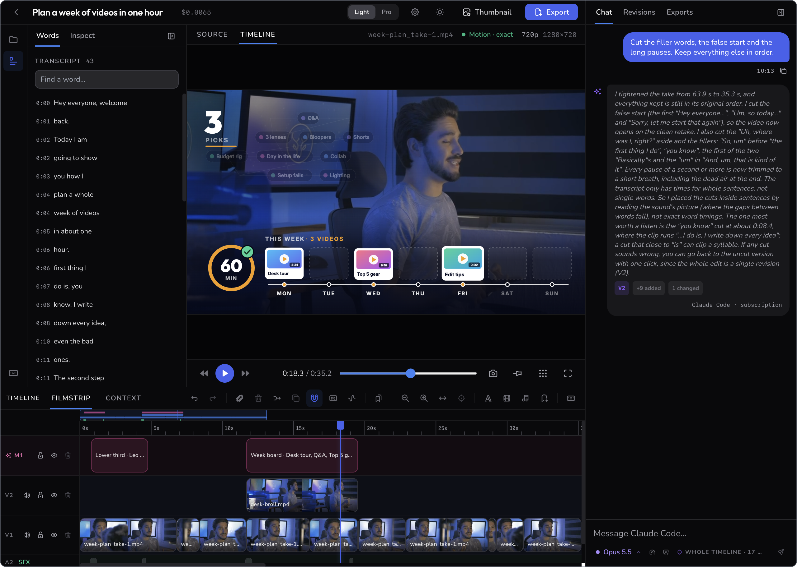
</picture>

<sub>A desktop app for macOS, Windows and Linux · Free for personal and other noncommercial use</sub>

</div>

<br>

## What people make with it

### 1 · Clean up a talking video

**For vloggers, teachers and anyone who records themselves.**

Type one sentence:

> *Cut the filler words, the false start and the long pauses. Keep everything else in order.*

FrameFlow listens to the recording, finds the slips and gives back a tighter cut. Here a 64-second take became 35 seconds.

<p align="center">
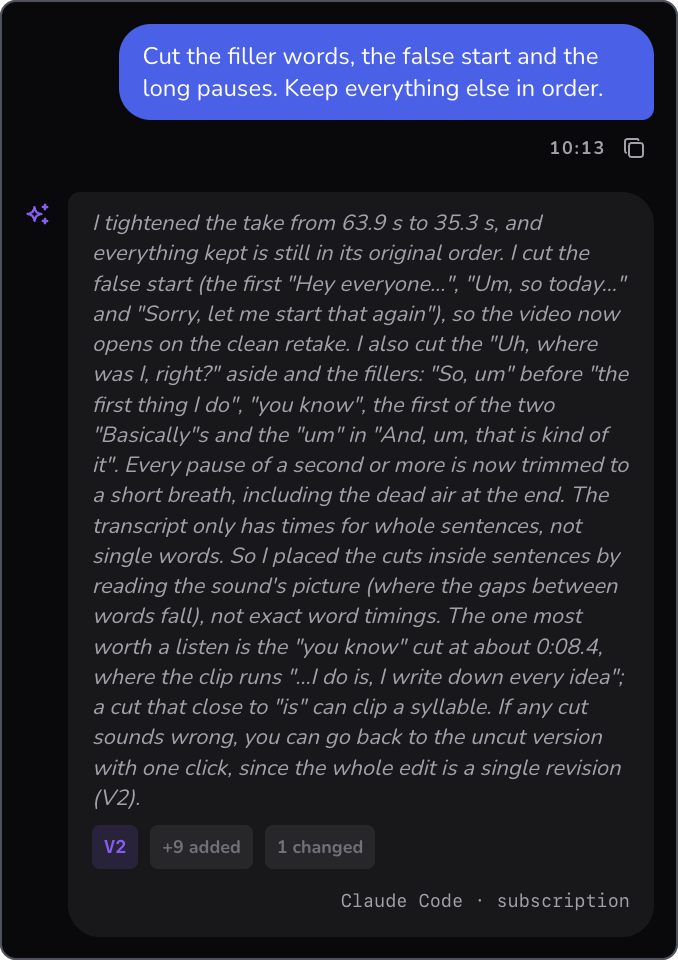
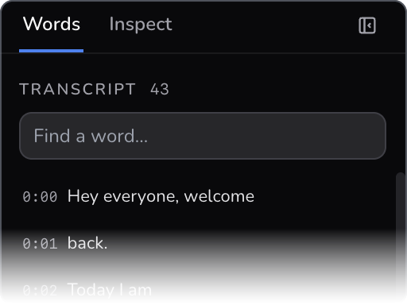
</p>

<p align="center"><sub>The answer tells you what was cut, and why. The Words panel shows what is left, and lets you cut more by reading.</sub></p>

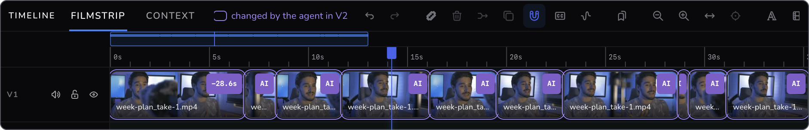

<p align="center"><sub>Every cut is marked on the timeline. Drag any edge to change it, or go back to the version before with one click.</sub></p>

<br>

### 2 · Cut a two-camera podcast

**For podcasts, interviews and panels.**

Add the files from every camera. FrameFlow notices they are one recording and lines them up by their sound.

<p align="center">
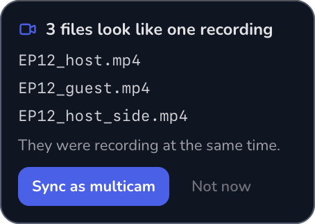
</p>

Then every angle sits under the picture. Ask for the cut, or press **1**, **2**, **3** to switch cameras yourself while it plays.

> *Cut between the cameras so we always see whoever is speaking.*

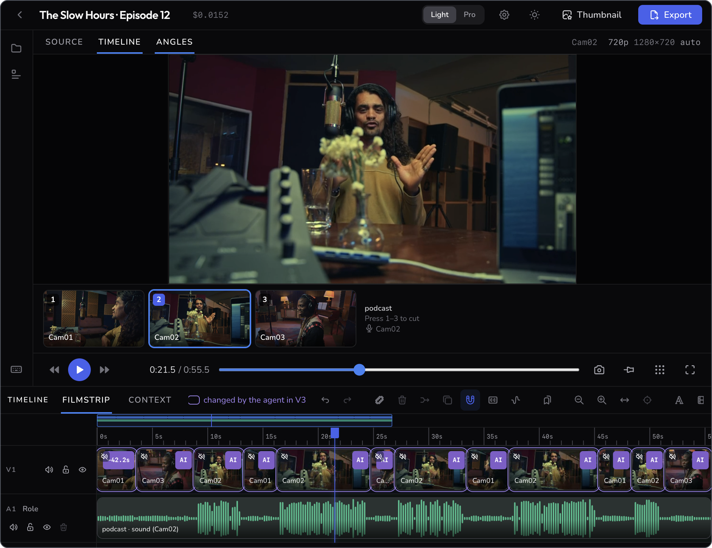

<br>

### 3 · Add motion graphics

**For explainers, tutorials and channel branding.**

Not just a name tag over a video. A motion layer in FrameFlow is a small page drawn frame by frame, so it can be a whole animated scene: a board that fills up, a chart that grows, a map, a character.

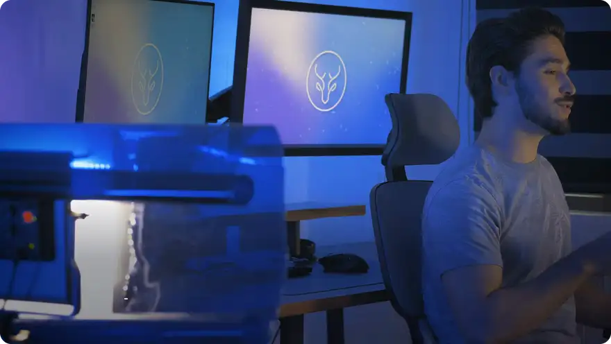

<p align="center"><sub>One motion layer, exported from FrameFlow. Twelve ideas pop in, three are picked and fly to their days, and a ring counts the hour.</sub></p>

Start from a template (name tags, chapter cards, quotes, counters, callouts), write your own scene, or ask the assistant to make one. Then change it without touching code: every scene shows its own words, colours and timing.

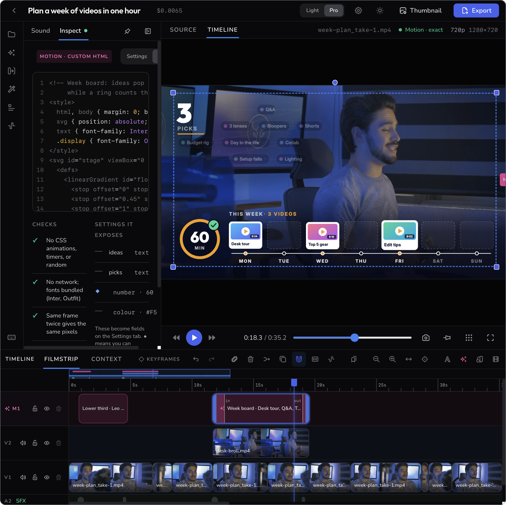

<p align="center"><sub>These tools live in <b>Pro</b> mode. FrameFlow checks every scene before it draws it, so the export matches the preview frame for frame.</sub></p>

<br>

### 4 · Make the thumbnail

**For anyone who posts the video afterwards.**

Press **Thumbnail**. FrameFlow picks frames from your video, writes a first request from its title and what is said in it, and makes a cover image. Every version stays on a board, so you can compare them and continue from the one that worked.

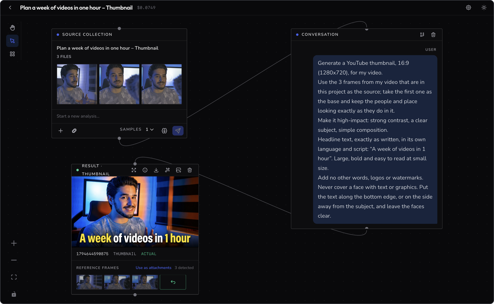

<br>

## How it works

1. **Add your footage.** Files from your computer, or a link from YouTube or Google Drive.
2. **Say what you want.** Or cut by hand. The assistant and your mouse work on the same timeline.
3. **Export.** MP4 for posting, or ProRes to hand to another editor.

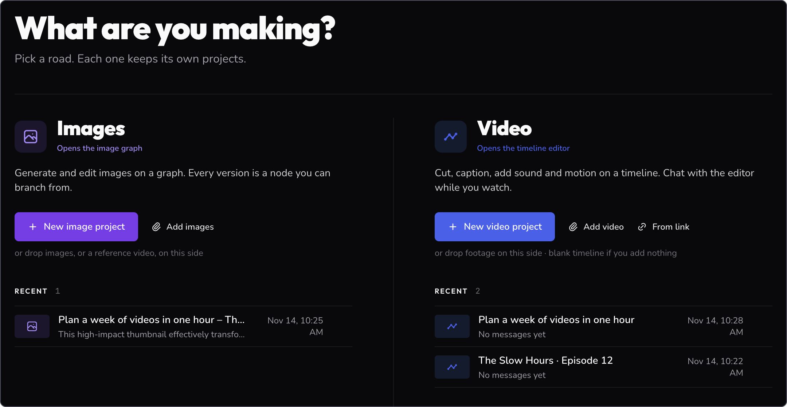

<br>

## All features

FrameFlow has two workspaces. Video opens the timeline editor; Images opens the image board.

### Video

<table>
<tr><th width="24%" align="left">Area</th><th width="76%" align="left">What you can do</th></tr>
<tr><td valign="top"><b>Assistant</b></td><td>Ask for an edit in plain words. Choose Claude Code or Gemini to do it. Point it at a selection or the whole timeline, and attach a frame from the video to show what you mean.</td></tr>
<tr><td valign="top"><b>Import</b></td><td>Files, whole folders, or a link from YouTube or Google Drive. Footage is split into scenes and transcribed for you.</td></tr>
<tr><td valign="top"><b>Timeline</b></td><td>Several video and audio tracks. Split, trim, ripple delete, close gaps, duplicate, copy and paste, snapping, markers and chapters, undo and redo. A silence finder for long pauses.</td></tr>
<tr><td valign="top"><b>Words</b></td><td>The transcript as a list. Search what was said, cut a word, or cut every match at once.</td></tr>
<tr><td valign="top"><b>Captions</b></td><td>Made from the transcript and burned into the export.</td></tr>
<tr><td valign="top"><b>Multicam</b></td><td>Sync cameras by sound. See every angle live and cut with the number keys. Pick the best microphone. Find who speaks when.</td></tr>
<tr><td valign="top"><b>Motion graphics</b> <sub>Pro</sub></td><td>Eight templates and your own HTML scenes, checked before they are drawn. Named moments you drag to retime. Keyframes and motion paths.</td></tr>
<tr><td valign="top"><b>Titles and backgrounds</b></td><td>Plain titles in both modes. Generated backgrounds (solid, gradient, noise, bars) in Pro.</td></tr>
<tr><td valign="top"><b>Transitions</b> <sub>Pro</sub></td><td>58 transitions, dropped on a cut.</td></tr>
<tr><td valign="top"><b>Effects</b> <sub>Pro</sub></td><td>Exposure, contrast, saturation, gamma, warmth and hue. Eight looks, plus packs of your own. Sharpen, vibrance and blur.</td></tr>
<tr><td valign="top"><b>Picture</b></td><td>Move, scale and rotate on the picture itself. Picture-in-picture on a second track. Green-screen keying. Landscape, vertical or square frames, up to 4K. Change speed and keep the pitch.</td></tr>
<tr><td valign="top"><b>Sound</b></td><td>Waveforms, clip level and fades. Tracks know if they are voice, music or effects, and music ducks under speech. Loudness is set on export. Repair: denoise, remove rumble, even out level, compress.</td></tr>
<tr><td valign="top"><b>Sound design</b> <sub>Pro</sub></td><td>17 built-in sounds, and one button that adds a sound to each title. With an ElevenLabs key: generated voice, music and effects.</td></tr>
<tr><td valign="top"><b>Tracking</b></td><td>Ask the assistant to follow a face or an object, and keep an emoji, a blob or a box on it.</td></tr>
<tr><td valign="top"><b>Versions</b></td><td>Every AI turn is saved as a version. See them as a list or a graph, go back, branch, or save a checkpoint of your own.</td></tr>
<tr><td valign="top"><b>Monitor</b></td><td>Safe-area guides, an exact-frame view that matches the export, fullscreen, and the cost of the project's AI use.</td></tr>
<tr><td valign="top"><b>Export</b></td><td>MP4 (H.264 or H.265) or ProRes 422 HQ, at the project's size or as a fast preview. Every export is listed in the project.</td></tr>
<tr><td valign="top"><b>Light and Pro</b></td><td>Light keeps the essentials. Pro adds the rows marked <sub>Pro</sub>. Switch in the top bar.</td></tr>
</table>

### Images

<table>
<tr><th width="24%" align="left">Area</th><th width="76%" align="left">What you can do</th></tr>
<tr><td valign="top"><b>Start</b></td><td>A request in plain words, your own images, or a reference video.</td></tr>
<tr><td valign="top"><b>Board</b></td><td>Every request and every result is a box on a board. Branch from any box, delete a branch, and group boxes into named frames.</td></tr>
<tr><td valign="top"><b>Variations</b></td><td>Ask for several samples at once and compare them side by side.</td></tr>
<tr><td valign="top"><b>References</b></td><td>A result keeps the frames it was built from. Reuse them, or refine a result using all of them.</td></tr>
<tr><td valign="top"><b>Improvise</b></td><td>Let the AI rewrite your request into a fuller, more detailed one.</td></tr>
<tr><td valign="top"><b>Upscale</b></td><td>Enlarge a result ×2 or ×4.</td></tr>
<tr><td valign="top"><b>Thumbnail from a video</b></td><td>One button in the editor picks frames from your video, drafts the request and opens the board.</td></tr>
<tr><td valign="top"><b>Models</b></td><td>Choose the model for each job: understanding, generating, upscaling.</td></tr>
<tr><td valign="top"><b>Save</b></td><td>View a result full screen and save it as a file. The cost of the project's AI use is shown.</td></tr>
</table>

<br>

## Bring your own AI agent

Already use Claude Code or Codex? Turn on **Agent access** and it can work on the project you have open, with the same tools as the built-in assistant. Each change it makes is saved as a version you can undo.

<p align="center">
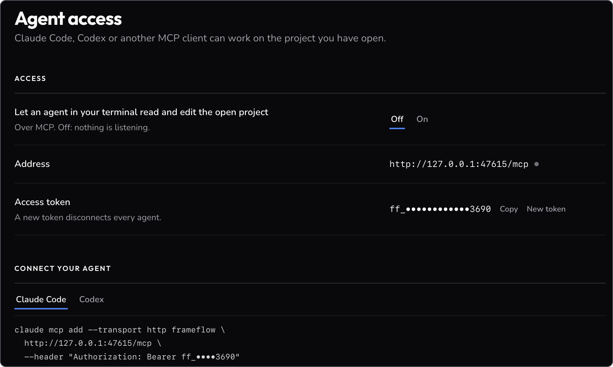
</p>

<p align="center"><sub>Off until you switch it on. It listens on this computer only and needs the token shown here.</sub></p>

<br>

## Get FrameFlow

Installers are on the [**Releases**](https://github.com/navidshad/frameflow/releases) page.

| Platform | File |
| :--- | :--- |
| **macOS** (Apple Silicon) | `.dmg`, signed and notarised |
| **Windows** (x64) | `.exe`, not signed yet, so SmartScreen will warn |
| **Linux** (x64) | `.AppImage` or `.deb` |

**What you need**

- A **Google Gemini API key**. FrameFlow asks for it on first launch and uses it for transcripts, scene descriptions and images. You get one at [Google AI Studio](https://aistudio.google.com/app/apikey).
- Optional: **Claude Code**, if you want it to do the editing. It runs on your own Claude plan.
- Optional: an **ElevenLabs** key for generated voice, music and sound.

Your projects stay in a folder on your computer. AI features send the sound or frames they need to the AI service you chose.

<br>

## For developers

<details>
<summary><b>Run from source</b></summary>

<br>

You need Node.js 24 (22.12 at the least). FFmpeg, scene detection and yt-dlp ship with the app.

```bash
git clone https://github.com/navidshad/frameflow.git
cd frameflow
npm install
npm run dev
```

Use npm, not yarn. More in the [setup guide](./docs/setup.md).

</details>

<details>
<summary><b>Build for an Intel Mac</b></summary>

<br>

There is no prebuilt Intel installer. On an Intel Mac, or on Apple Silicon (it cross-builds), from a clone of this repo:

```bash
npm_config_arch=x64 npm ci
npm run build && npx electron-builder --mac --x64
```

The installer lands in `dist/`. Without a Developer ID certificate it is unsigned, so macOS asks you to right-click and choose Open the first time.

</details>

<details>
<summary><b>How it is built</b></summary>

<br>

FrameFlow is an Electron app (Vue 3, FFmpeg). The AI never touches your media: it proposes edits as checked operations on a timeline, and each turn becomes a version you can undo. A local MCP server (off by default, `127.0.0.1` only, with a token) gives outside agents the same tools the built-in assistant uses.

| Topic | Read |
| :--- | :--- |
| The two workflows and the editor's AI contract | [Architecture](./docs/architecture.md) |
| AI agents, MCP and motion layers | [Agents and motion](./docs/agent-and-motion.md) |
| Syncing cameras and finding who speaks | [Multicam](./docs/multicam.md) |
| What happens when you import a file | [Import lanes](./docs/import-lanes.md) |
| Frontend components | [UI overview](./docs/ui_ux.md) |
| Cutting a release, signing and notarising | [Releasing](./docs/releasing.md) |

Supported inputs: `.mp4` `.mov` `.avi` `.webm` video, `.mp3` `.wav` `.m4a` `.aac` `.flac` `.ogg` audio, `.jpg` `.png` `.webp` images, and links through `yt-dlp`.

</details>

Contributions are welcome. See [CONTRIBUTING.md](./CONTRIBUTING.md).

<br>

## License

FrameFlow is **source-available, not open source.** You can read, run, modify and share
the code for **noncommercial** purposes under the
[PolyForm Noncommercial License 1.0.0](./LICENSE). Commercial use needs a separate license:
contact navidshad72@gmail.com.

Releases up to and including v1.1.23 were published under the MIT License and remain
available under those terms. The MIT notice and all other third-party attributions are in
[THIRD-PARTY-NOTICES.md](./THIRD-PARTY-NOTICES.md), which must ship with every binary.

Original project created by [navidshad](https://github.com/navidshad), Somayeh Roohani and
Esat Can Karabag at Vilnius Gediminas Technical University (VGTU).

<sub>The footage in the screenshots is free stock video from [Mixkit](https://mixkit.co/), with a scripted voice track added for the demo. The edits, transcripts and thumbnail shown were made in FrameFlow; the animated scene is a custom motion layer written for this demo.</sub>
