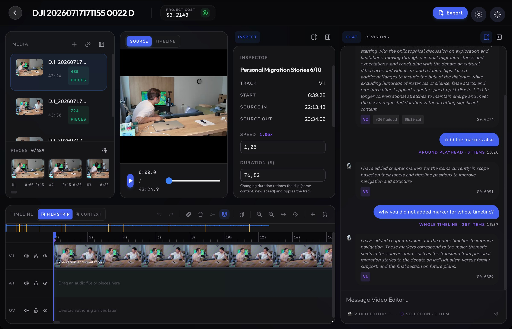
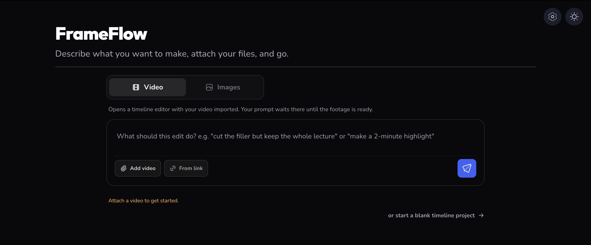
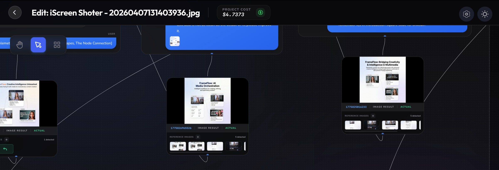

  # 🌊 FrameFlow

---

  **FrameFlow** is a high-fidelity multimedia platform that bridges the gap between raw video/image assets and creative intelligence. By fusing **Google Gemini's** multimodal brain with precise **FFmpeg** engineering, FrameFlow transforms how you consume, extract, and generate media.

  
  
  
  
  

---

## 🚀 The Three Pillars of FrameFlow

FrameFlow splits work by **what you are making**, not by what you upload. Video and
audio go to a timeline; images go to a node graph.

### 1. 🎞️ Video → Video (the timeline editor)
A real multi-track timeline with an AI editor sitting next to it.
- **Say what you want, at any length**: *"cut the filler but keep the whole lecture"* and
  *"make a 2-minute highlight"* are both just prompts — nothing presets a runtime.
- **Always editable**: the AI proposes a timeline, not a rendered file, so you can drag
  any edge it got wrong instead of re-prompting.
- **Branchable history**: every AI turn becomes a revision you can switch to or branch
  from, viewable as a list or a graph.
- **Manual tools too**: split, ripple-delete, retime, markers, chapters, silence finder.

### 2. 📸 Video → Thumbnail
Generate a cover image from footage.
- **Frame-aware**: the video is sampled and analysed, so you can say *"use the moment at
  the train station"* and it knows which one you mean.
- **Designed, not just rendered**: composition rules (rule of thirds, contrast, subject
  consistency) are baked into the generator.

### 3. 🎨 Images → Image (the node graph)
Branching exploration for still images.
- **Compare, then branch**: generate several variants side by side and continue from the
  one that worked — which is what a canvas is good at and a linear chat is not.
- **Multimodal fusion**: combine your own images with frames pulled from a reference video.
- **Prompt-driven refinement**: iterate in natural language, with every result kept.

---

## 🤖 In progress: AI agents and motion graphics

FrameFlow is gaining three abilities: an **MCP server**, so agents like Claude Code and
Codex can read and edit your open project; an **HTML motion layer** (templates, custom
HTML and keyframes); and your **own AI CLI as the editing engine**.

- **Design (the UI to build, exactly as drawn):** https://claude.ai/artifact/CWdPbiqvmizwszhTXgpKb5
- **Plan, decisions and stages:** [docs/agent-and-motion.md](docs/agent-and-motion.md)

## 🧩 Supported Inputs

FrameFlow handles a wide range of media formats and sources:

- **Video Formats**: Native support for `.mp4`, `.avi`, `.mov`, and `.webm`.
- **Audio**: `.mp3`, `.wav`, `.m4a`, `.aac`, `.flac`, `.ogg` — audio-only projects work on the timeline too.
- **Online Sources**: YouTube, Google Drive, and direct media URLs (via `yt-dlp`).
- **Images**: High-fidelity `.jpg`, `.png`, and `.webp` for structural reference and multimodal generation.
- **Optimization**: High-res videos are automatically downscaled (480p) to ensure lightning-fast AI analysis without losing metadata.

---

## 🎨 Premium Experience (UX)

FrameFlow isn't just a tool; it's an iterative workspace:

- **Timeline Editor**: Multi-track editing with a program monitor, filmstrip/context views,
  clip tray, and an AI prompt bar with swappable editor personas.
- **Vue Flow Graph Interface**: Branch image generations — and browse your edit history as
  a revision tree — visually.
- **Live Metrics**: Monitor AI token usage and processing costs in real-time.
- **Zero-Config Preprocessing**: Automatic scene detection and transcript extraction.
- **Ambient Design**: A sleek, dark-mode-first interface with glassmorphism and smooth animations.

---

## 🧭 Navigation & Setup

| Section | Link | Purpose |
| :--- | :--- | :--- |
| 🏗 **Architecture** | [**Deep-Dive**](./docs/architecture.md) | The two workflows, media pre-processing, and the editor's AI contract. |
| 🚀 **Installation** | [**Setup Guide**](./docs/setup.md) | Node.js, Gemini API, FFmpeg, and yt-dlp setup. |
| 🎨 **UI/UX** | [**Design Overview**](./docs/ui_ux.md) | Frontend components and interaction flow. |
| 📦 **Releasing** | [**Build & Signing**](./docs/releasing.md) | Cutting a release, code signing, and notarisation. |

---

## 📸 Interface Preview

**Starting a project** — one composer. Say what you want, attach files, go.

  

**The node graph** — branching image generation, where each result keeps the reference
images it was built from, so you can compare variants and continue from the one that worked.

  

---

## 📜 License

FrameFlow is **source-available, not open source.** You can read, run, modify and share
the code for **noncommercial** purposes under the
[PolyForm Noncommercial License 1.0.0](./LICENSE). Commercial use needs a separate license:
contact navidshad72@gmail.com. Contributions are welcome — see
[CONTRIBUTING.md](./CONTRIBUTING.md).

Releases up to and including v1.1.23 were published under the MIT License and remain
available under those terms. The MIT notice and all other third-party attributions are in
[THIRD-PARTY-NOTICES.md](./THIRD-PARTY-NOTICES.md), which must ship with every binary.

Original project created by [navidshad](https://github.com/navidshad), Somayeh Roohani and
Esat Can Karabag at Vilnius Gediminas Technical University (VGTU).

---

> [!TIP]
> **Pro Choice:** Check the **[Architecture Deep-Dive](./docs/architecture.md)** to see how the AI proposes edits as validated *ops* rather than touching media directly.
